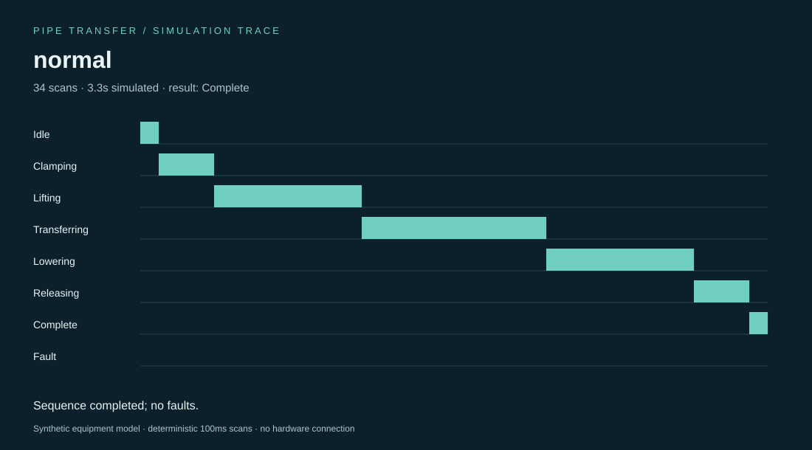
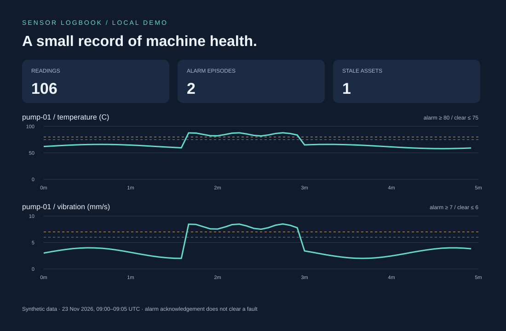
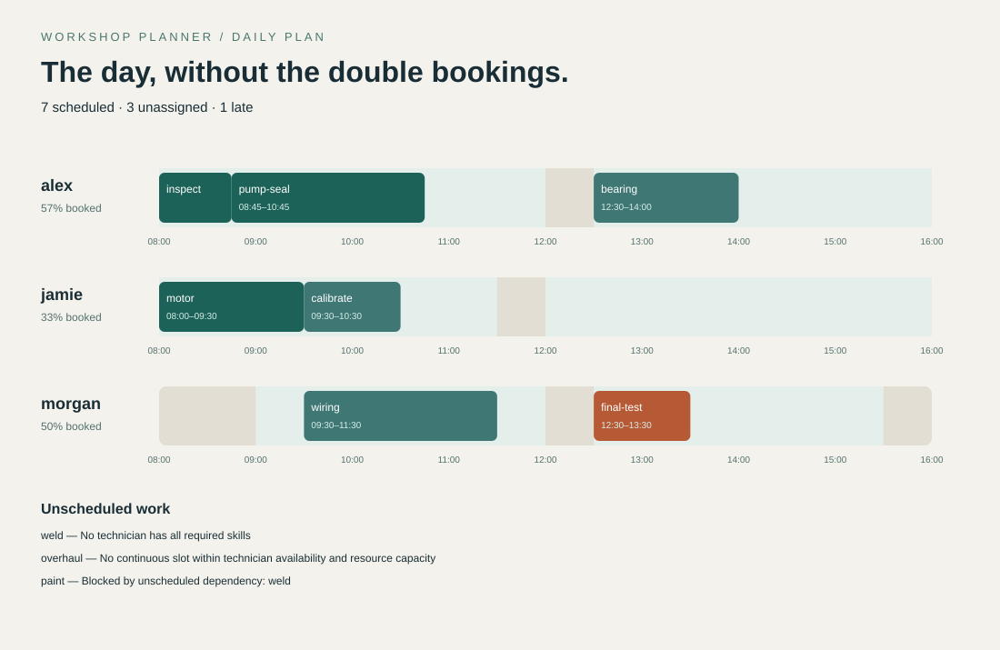

# projects
repository for hobby projects which I use to learn

## Featured engineering projects

Three practical projects built around readable code, reproducible demos, and tests. Developed locally on personal hardware and uploaded to GitHub on **11/23/2026 (November 23, 2026)**.

| Project | Stack | What it demonstrates |
| --- | --- | --- |
| [Pipe Transfer Simulator](pipe-transfer-simulator/) | C# / .NET | Machine sequencing, interlocks, fault injection, deliberate recovery, JSON/CSV traces |
| [Sensor Logbook](sensor-logbook/) | Python / SQLite | Local HTTP ingestion, persistent alarm history, retries, stale-data detection, SVG reporting |
| [Workshop Planner](workshop-planner/) | JavaScript / Node.js | Skill matching, dependencies, shared equipment, schedule validation, timeline reporting |

### Pipe Transfer Simulator

An independent controller and simulated plant complete a pipe transfer through six motion stages. Four repeatable scenarios show a normal cycle, an open guard, lost clamp feedback, and an actuator timeout. Eleven tests check sequencing and recovery.

### Sensor Logbook

A small transactional sensor service records readings and alarm episodes in SQLite. Identical retries are accepted, conflicting sequences are rejected, and alarm acknowledgement is kept separate from recovery. Thirteen tests include real loopback HTTP requests and transaction rollback.

### Workshop Planner

A deterministic scheduler assigns jobs to qualified technicians while respecting breaks, dependencies, and shared equipment. It explains unscheduled work and generates JSON, Markdown, and SVG reports. Seventeen tests include 100 generated workloads checked for scheduling conflicts.

Each folder contains its own setup instructions, design choices, example output, and limitations. The repository workflow runs all three test suites. The projects use synthetic inputs and do not require hardware, paid services, or external package dependencies.

## Earlier learning projects

The existing game and Python exercise folders are retained alongside these projects.
