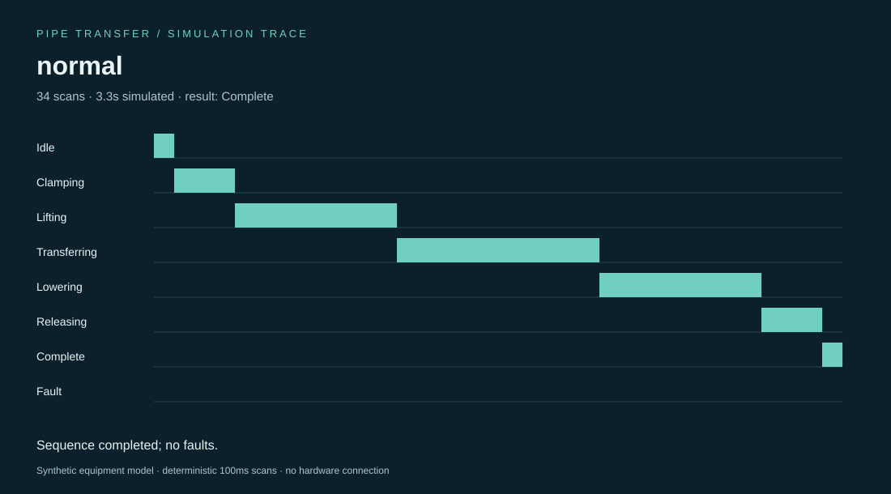
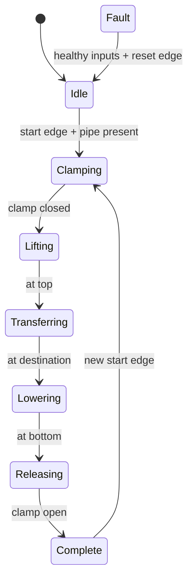

# Pipe Transfer Simulator

By Sam Bersa. Developed locally on personal hardware; uploaded to GitHub on **11/23/2026 (November 23, 2026)**.

A small C# console project that simulates moving a pipe between two stations. The focus is a readable state machine, predictable scan behavior, and recovery after faults.

**Stack:** C# / .NET 9. No external packages or hardware required.



## Run

Install the .NET 9 SDK, then from this directory:

```sh
dotnet run
dotnet run -- --fault
dotnet run -- --test
dotnet run -- --scenario normal --out demo-output
dotnet run -- --scenario actuator-stall --out stalled-output
```

The demo prints one JSON object per 100ms scan. A separate plant model responds to commands after fixed actuator delays. The normal run reaches `Complete`; `--fault` opens a guard during transfer and leaves the controller in `Fault`, with all simulated output commands off. Tests return a nonzero exit code on failure.

`--scenario` supports `normal`, `guard-open`, `clamp-loss`, and `actuator-stall`. `--out` saves input/output snapshots as JSON, a CSV event trace, and an SVG state timeline. Repeated runs produce the same trace. Committed examples show all four scenarios, including the first fault diagnosis. Intentional fault demos return exit code zero; invalid CLI arguments and failed tests return nonzero.

## Sequence



Every state can enter `Fault` if an interlock fails. Motion steps also have a five-second simulated timeout. A fault stays latched until its cause is clear and the operator presses reset again. Reset never starts a transfer; a separate, fresh start edge is required.

## Design choices

- `Controller.Scan` takes one immutable sensor snapshot and returns one output snapshot. Console I/O stays outside the controller.
- Simulated time advances by the supplied scan duration, so tests do not sleep or depend on wall-clock timing.
- Emergency stop, guard, pressure, and communication status are checked before sequence logic. The first fault is retained for troubleshooting.
- A lost clamp signal during transport stops the sequence. Timeout wins if completion arrives exactly at its deadline.
- The plant and controller are separate: the plant responds to output commands, and the controller only sees sensor snapshots. Fixed delays keep faults easy to reproduce.

## Test coverage

Eleven scenario tests exercise the full cycle, held commands, missing pipe, each interlock, lost clamp feedback, timeout boundary, latched faults, reset behavior, first-cause retention, invalid scan durations, and all four plant scenarios. The emergency stop is also injected at every sequence stage.

## Scope and limitations

This is an educational software simulation, not NOV software or a real machine controller. `CommunicationOk` is an injected status signal, not a networking implementation. Sensor plausibility, actuator feedback, and restart homing are simplified. Switching a simulated clamp command off is not a real load-holding design; real machinery requires independent safety systems and a machine-specific risk assessment.

An extension would be a separate plant simulator and contradictory-sensor checks, while keeping the controller independent of transport and UI.
