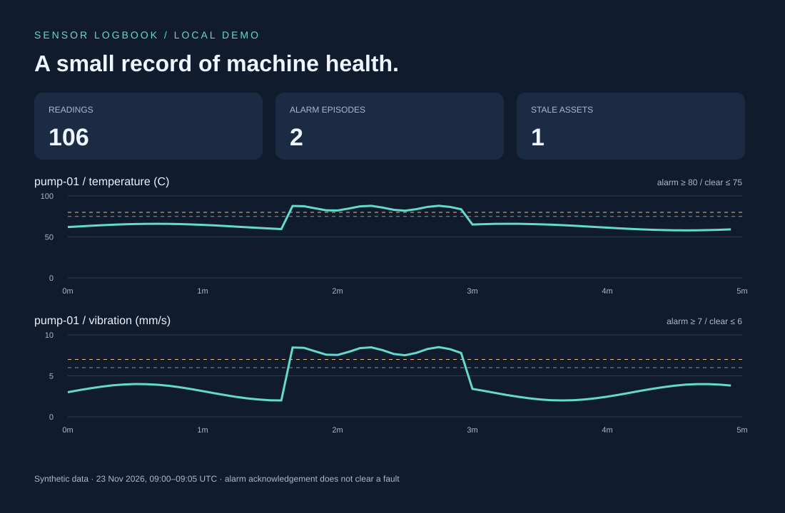

# Sensor Logbook

By Sam Bersa. Developed locally on personal hardware; uploaded to GitHub on **11/23/2026 (November 23, 2026)**.

A lightweight Python tool for recording machine sensor readings, keeping an alarm history, and exporting evidence for troubleshooting. SQLite stores the data; a small local HTTP API lets another process submit readings.

**Stack:** Python 3.11+ and SQLite, using only the Python standard library.



## Try the demo

```sh
python logbook.py --db demo.sqlite demo
python -m unittest -v
```

Open `demo-output/report.svg` to see the generated chart. The fixed dataset contains **106 readings**, **two alarm episodes**, one acknowledged alarm, and one asset that stops reporting. Re-running the demo does not duplicate readings or alarm episodes. Committed sample output is in `examples/`.

## Record, inspect, export

```sh
python logbook.py --db logbook.sqlite ingest examples/reading.json
python logbook.py --db logbook.sqlite status
python logbook.py --db logbook.sqlite export readings.csv
python logbook.py --db logbook.sqlite ack 1
```

The sample file is historical synthetic data. `status` uses the current time, so old readings will correctly show as stale.

## Local API

In PowerShell:

```powershell
$env:LOGBOOK_TOKEN = python -c "import secrets; print(secrets.token_urlsafe(24))"
python logbook.py serve
```

Keep that terminal running. In a separate terminal set the same token, then:

```powershell
$headers = @{ Authorization = "Bearer $env:LOGBOOK_TOKEN" }
$body = @{ asset = 'pump-01'; sequence = 1; timestamp = [DateTime]::UtcNow.ToString('o'); temperature = 83; vibration = 4.2 } | ConvertTo-Json
Invoke-RestMethod http://127.0.0.1:8765/readings -Method Post -Headers $headers -ContentType application/json -Body $body
Invoke-RestMethod http://127.0.0.1:8765/status -Headers $headers
```

| Endpoint | Behavior |
| --- | --- |
| `POST /readings` | 201 inserted; 200 identical retry; 400 invalid/conflicting/out-of-order reading |
| `GET /status` | Latest reading per asset, stale flags, and alarm history |
| Either endpoint without token | 401 |

The server binds only to `127.0.0.1`. The token is supplied through an environment variable, never saved in the repository. This is a local development API; it uses Python's basic HTTP server, not a hardened production server. A network deployment would need TLS, request timeouts, rate limits, and a production server.

## Alarm behavior

| Metric | Open alarm | Clear alarm | Unit |
| --- | --- | --- | --- |
| Temperature | ≥ 80 | ≤ 75 | °C |
| Vibration | ≥ 7 | ≤ 6 | mm/s |

These are illustrative limits for synthetic data, not equipment specifications. The gap between opening and clearing prevents repeated alarms around a single threshold. Acknowledging means an operator has seen an alarm; it never clears the underlying condition. A recovery closes the episode, and a later excursion opens a new episode.

## Reliability choices

- Reading insertion and alarm transitions share one SQLite transaction. A partial failure cannot save a reading without its alarm update.
- `(asset, sequence)` identifies a message. Identical retries are accepted without duplication; conflicting reuse is rejected.
- Sequence and UTC-normalized timestamps must both increase for each asset. Late readings are rejected rather than allowed to rewrite alarm history.
- Inputs reject nonfinite values, booleans masquerading as numbers, implausible ranges, and timestamps without timezones. SQL uses bound parameters.
- An asset is stale after more than 30 seconds without a reading; stale data does not clear an alarm.

Thirteen tests cover persistence, alarm hysteresis, acknowledgement, transaction rollback, retries, ordering, stale boundaries, invalid data, CSV export, deterministic demo output, and real loopback HTTP requests.

## Boundaries

This is an independent portfolio project with synthetic pump data. It does not connect to industrial equipment or implement a PLC protocol. The report renderer is intentionally tailored to the fixed demo's `pump-01`; the store and API accept arbitrary asset IDs. Storage retention, configurable limits, and pagination are sensible next steps before larger datasets.
