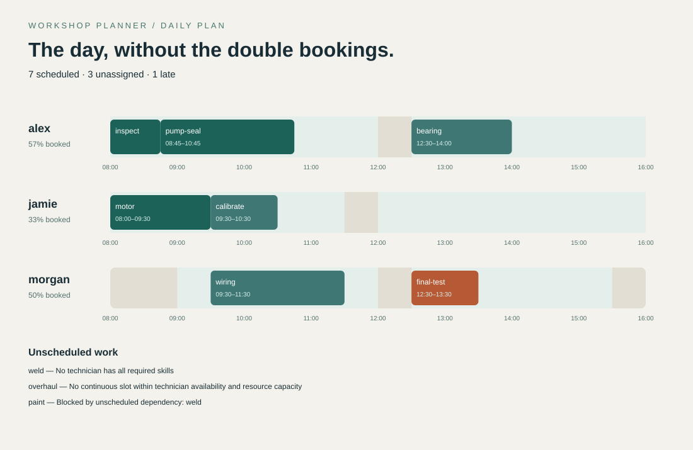

# Workshop Planner

By Sam Bersa. Developed locally on personal hardware; uploaded to GitHub on **11/23/2026 (November 23, 2026)**.

A practical JavaScript command-line tool that turns a list of maintenance jobs into a daily technician schedule. It handles skills, breaks, job dependencies, and shared equipment, and explains work it cannot fit.

**Stack:** Node.js 22+. No npm dependencies or installation step.



## Run

```sh
npm test
npm run demo
node cli.js examples/workshop.json --out my-plan
```

The CLI produces `plan.json` for other tools, `plan.md` for a readable table, and `plan.svg` for a portable timeline. In the sample, **seven of ten jobs** are assigned. A welding job lacks a qualified technician, its dependent job is blocked, and a long overhaul cannot fit within any uninterrupted availability window.

## Input model

`examples/workshop.json` is a complete editable example. Times are integer minutes from the start of a single planning day; reports display an 08:00 start. Availability windows model shifts and breaks. Each job requires one technician who possesses all required skills, with an optional shared resource such as a lifting bay.

| Job field | Meaning |
| --- | --- |
| `id`, `title` | Stable ID and readable name |
| `duration` | Continuous working minutes; jobs cannot be split |
| `priority` | 1 is highest, 3 is lowest |
| `due` | Desired finish minute; late work remains visible |
| `skills` | All skills required from one technician |
| `dependsOn` | Jobs that must finish first |
| `resource` | Optional shared equipment ID; one job at a time |

## How the planner decides

1. Validate IDs, ranges, availability, dependencies, and cycles.
2. Among dependency-ready jobs, choose priority first, then earliest due time, then ID.
3. Find the earliest continuous slot for each qualified technician, avoiding both technician and shared-equipment bookings.
4. Pick earliest completion; break ties using current workload and then technician ID.
5. Explain any rejected job and propagate dependency failures.
6. Independently check that the final plan has no double bookings, missing jobs, skill mismatches, or precedence violations.

This is a deterministic greedy heuristic, not an optimal scheduling solver. For example, it may give a broadly skilled technician an easy job and leave a specialized job unassigned later, even though another arrangement would fit. That tradeoff keeps the algorithm understandable. Backtracking or a small local search would be a useful next step if plan quality became more important than simplicity.

## Testing

Seventeen tests cover skills, due dates, priorities, breaks, dependencies, shared equipment, invalid data, deterministic output, report escaping, and a deliberately corrupted plan. A seeded test also generates **100 workloads** of 25 jobs and verifies every plan against feasibility constraints.

## Scope

One planning day, one technician per job, capacity-one shared resources, and no travel time. The tool does not claim that scheduled maintenance is completed. All example names and jobs are fictional. The SVG is a report, not a web application; it can be opened directly in a browser or viewed on GitHub.
